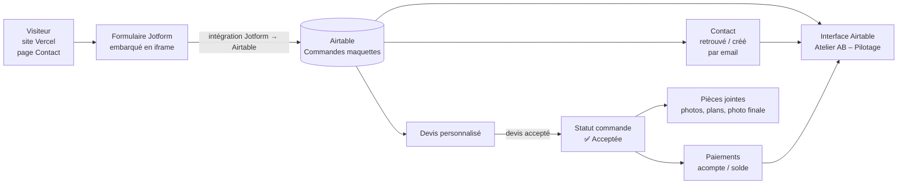
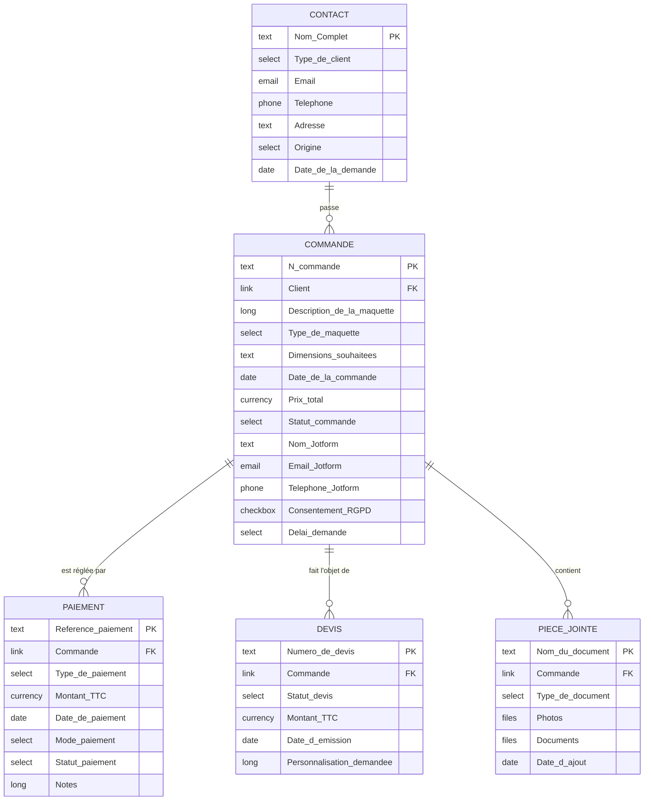

# Projet fil rouge — Atelier Alain Bourgeon (maquettes sur mesure)

Trophée visé : **Business automation starter**
Outils : Airtable · Jotform · Vercel (site) · (bonus) agent IA
Base Airtable : **Fil Rouge Atelier AB – V3 (sur-mesure)** — `appbxuLcBzxWj5ZcU`

---

## 1. Le besoin

L'atelier fabrique des maquettes d'architecture artisanales. Les modèles classiques se vendent directement sur le site (panier). Les **maquettes sur mesure** passent par un parcours différent : demande → devis → acceptation → fabrication → paiements (acompte + solde) → livraison. Avant ce projet, ce suivi n'avait pas d'outil dédié : un client = un mail à retrouver.

**Objectif** : un CRM de commandes sur mesure, alimenté automatiquement depuis le site, qui permette de voir en un coup d'œil où en est chaque commande et chaque paiement.

## 2. Le process

Étapes :

1. Le visiteur remplit le formulaire Jotform (`262614694189065`), intégré dans `contact.html` du site déployé sur Vercel. Consentement RGPD obligatoire.
2. Jotform envoie la réponse dans Airtable : une ligne dans **🎨 Commandes maquettes** (nom, email, téléphone, projet, délai, photos, documents, consentement).
3. L'email sert de clé pour rattacher la commande au bon **👤 Contact**.
4. Alain prépare un **📄 Devis**. Quand il est accepté, la commande passe en « ✅ Acceptée » et le prix total est saisi.
5. Les **💰 Paiements** (acompte, solde) sont enregistrés et liés à la commande.
6. Les **📎 Pièces jointes** classent photos de référence, plans et photo finale.
7. L'interface **Atelier AB – Pilotage** donne la vue d'ensemble.

## 3. Schéma de base de données

### Relations (toutes en lien Airtable bidirectionnel)

| Depuis | Vers | Cardinalité | Champ |
|---|---|---|---|
| Commande | Contact | plusieurs → un client | `Client` ↔ `🎨 Commandes maquettes` |
| Commande | Paiements | un → plusieurs (acompte + solde) | `💰Paiements` ↔ `Commande` |
| Commande | Devis | un → plusieurs (révisions) | `📄Devis personnalisé` ↔ `Commande` |
| Commande | Pièces jointes | un → plusieurs | `📎Pièces jointes` ↔ `Commande` |

## 4. Dictionnaire des tables et listes de choix

**👤 Contact** — fiche client.
Type de client : Particulier · Professionnel · Collectionneur.
Origine : Site internet · Recommandation · Réseaux sociaux · Salon / événement · Autre.
Délai souhaité : Moins d'1 mois · 1 à 3 mois · 3 à 6 mois · Pas pressé.

**🎨 Commandes maquettes** — une ligne par maquette sur mesure (identifiant `CMD-2026-XXX`, saisi à la main).
Statut commande : 🆕 Nouvelle demande → 📝 Devis envoyé → ✅ Acceptée → 🔨 En fabrication → 🚚 Livrée (ou ❌ Refusée / Annulée).
Les champs `Nom`, `Email`, `Téléphone`, `Consentement RGPD`, `Photos`, `Documents`, `Délai demandé` reçoivent directement la réponse Jotform.

**💰 Paiements** (`PAY-XXX`) — Type : Acompte · Solde · Paiement total. Mode : Chèque · Virement · Carte · Espèces. Statut : Payé · En attente · Impayé.

**📄 Devis personnalisé** (`DEV-2026-XXX`) — Statut : Brouillon · Envoyé · Accepté · Refusé · Expiré. Validité 15 jours à partir de la date d'émission.

**📎 Pièces jointes** — Type : Photo de référence · Plan ou croquis · Photo finale · Autre.

## 5. Interface — « Atelier AB – Pilotage »

| Page | Type | Contenu |
|---|---|---|
| Accueil | Tableau de bord | Nombre de commandes, chiffre d'affaires commandé (€), commandes par statut, paiements enregistrés, paiements par statut, nombre de clients, origine des clients |
| Commandes | Liste | N° commande, client, dimensions, prix total, statut (modifiables) |
| Clients | Liste | Nom, type, email, téléphone, origine, délai, date de la demande |
| Paiements | Liste | Référence, commande, type, montant, date, mode, statut |

## 6. Checklist des livrables demandés

| Livrable | État | Remarque |
|---|---|---|
| Schéma de base de données | ✅ Ce document (§3) | À exporter en PDF pour le coach |
| Base Airtable structurée (≥ 2 tables liées, champs documentés) | ✅ 5 tables, 4 liens, descriptions sur chaque champ | |
| Formulaire Jotform connecté | ⚠️ Publié et intégré au site, **flux vers Airtable non vérifié** | Voir §7 |
| Interface Airtable | ✅ 4 pages | Vérifier qu'elle est publiée / partageable |
| Bonus : agent IA | ⚠️ Chatbot Chatbase présent sur la page d'accueil du site | Pas relié au formulaire ni à la base : voir §8 |
| Bonus : vues personnalisées par accès | ❌ Non fait | |

## 7. Points faibles à régler avant la validation

1. **Le lien Jotform → Airtable n'est pas prouvé.** Les 4 commandes et 3 contacts de la base sont fictifs (« (fictif) », emails `@example.com`). Aucune ligne ne vient d'une vraie soumission. Aucune automatisation n'existe dans la base : si Jotform ne crée pas aussi le Contact et le lien `Client`, ce rattachement n'a lieu nulle part. **Test à faire** : soumettre le formulaire depuis le site en ligne, puis vérifier qu'une ligne apparaît dans Commandes, avec photos et consentement.
2. ~~Doublons Photos / Documents / projet / délai / consentement dans Contact~~ **Réglé le 14/10** : supprimés de Contact. La réception du formulaire vit uniquement dans Commandes maquettes ; Pièces jointes sert au classement par type.
3. **Nom, email, téléphone restent dans Commandes et dans Contact** : voulu, ce sont les champs saisis par Jotform qui servent à retrouver ou créer le contact. À mentionner au coach.
4. **`api/contact.js` dans le dépôt** écrit encore dans l'ancienne base « Fil Rouge 1 » (`appdGPOIhuP8pDo1d`). Le site utilise maintenant Jotform : ce code est mort, ou pire, il envoie encore des données ailleurs si l'ancien formulaire est réactivé. À retirer ou à documenter comme archive.
5. **Numérotation à la main** (`CMD-2026-XXX`, `DEV-…`, `PAY-…`) : source d'erreurs. Un champ Numéro automatique ou une formule règle le sujet.
6. **Prix total saisi à la main**, alors que le montant du devis accepté existe déjà. Un rollup du devis accepté éviterait deux sources de vérité.

## 8. Bonus : agent IA

**Existant** : un chatbot Chatbase est embarqué sur `index.html` (page d'accueil). Il n'est pas sur la page Contact (le bot vocal Jotform y a été retiré) et il n'écrit rien dans Airtable. La consigne parle d'un agent « intégré à votre formulaire ou à votre base » : tel quel, il peut être jugé hors critère. Deux façons de le rendre conforme : remettre un agent dans le formulaire Jotform, ou ajouter l'automatisation Airtable ci-dessous.

**Piste côté base** :

Le plus rentable et le plus simple à démontrer : une **automatisation Airtable avec bloc IA** déclenchée à la création d'une commande (« Nouvelle demande »), qui :
- résume la description du projet en 2 lignes,
- propose une estimation de complexité (simple / moyenne / complexe) selon les dimensions et le texte,
- écrit un brouillon de réponse au client.

Prérequis : champs `Résumé IA`, `Complexité IA`, `Brouillon réponse` dans Commandes, et un plan Airtable qui inclut les actions IA. Non créé à ce stade.

## 9. Pour la présentation au coach Discord

1. Montrer le schéma (§3).
2. Soumettre le formulaire en direct depuis le site Vercel.
3. Ouvrir Airtable : la ligne est apparue.
4. Passer la commande de « Nouvelle demande » à « Devis envoyé », ajouter un paiement.
5. Montrer le tableau de bord de l'interface.
